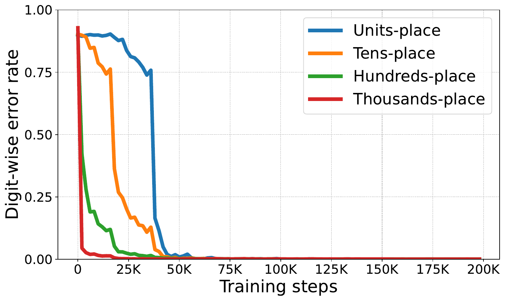
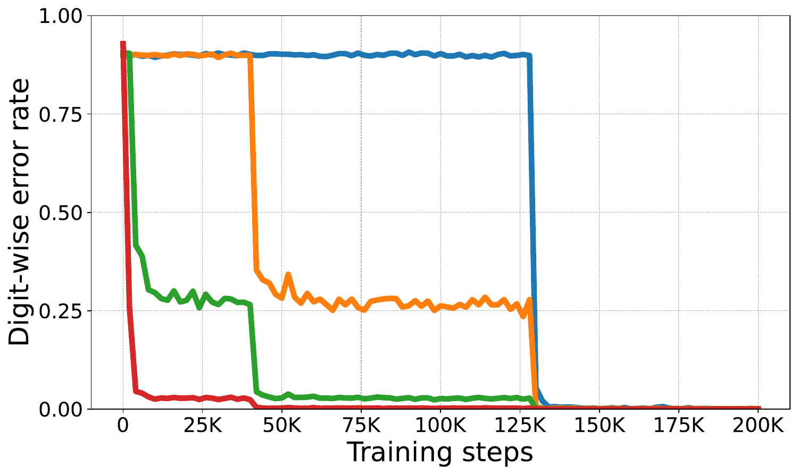

# Shattered Compositionality

### Counterintuitive Learning Dynamics of Transformers for Arithmetic

**Xingyu Zhao, Darsh Sharma, Rheeya Uppaal, and Yiqiao Zhong**

University of Wisconsin–Madison · **NeurIPS 2026, accepted**

[**Paper**](https://arxiv.org/abs/2601.22510) · [**Blog post by Yiqiao Zhong**](https://yiqiao-zhong.github.io/jekyll/update/2026/02/08/shattered-compositionality.html) · [**Reproduction guide**](docs/reproduction.md) · [**Citation**](#citation)

**How do transformers learn to put simpler skills together?** We study this question by training transformers on addition, multiplication, comparison, and sorting, then tracking individual subskills throughout training. These controlled tasks let us examine both *when* a skill emerges and *how the training distribution shapes its acquisition*.

We find that subskills often develop in reverse or in parallel relative to standard arithmetic procedures. Partially learned skills can then compete, producing fragile combinations and characteristic errors. We call this failure mode **shattered compositionality**.

This repository contains the synthetic-data generators, training code, evaluation tools, and analysis scripts used in the paper. For an accessible introduction to the motivation and results, start with [the accompanying blog post](https://yiqiao-zhong.github.io/jekyll/update/2026/02/08/shattered-compositionality.html).

## A surprising example: which digit is learned first?

Consider four-operand addition:

```text
Ordinary output:  349 + 102 + 382 + 907 = 1740
Reversed output:  349 + 102 + 382 + 907 = 0471
```

Standard column addition starts at the units place and propagates carries toward higher places. In our main experiments, transformers instead become accurate at the **thousands-place digit before the lower-place digits**. Reversing the answer format does not reverse this acquisition pattern.

<table>
  <tr>
    <th>Ordinary output order</th>
    <th>Reversed output order</th>
  </tr>
  <tr>
    <td></td>
    <td></td>
  </tr>
</table>

*Figure 1 from the paper. Each curve tracks the error rate for one answer digit across training checkpoints; the legend applies to both panels. Learning order here means when digit-level skills become reliable during training, not the order of internal calculations in a trained model.*

## What we found

1. **Skill acquisition need not follow the task's procedural hierarchy.** Addition exhibits higher-place-first learning, while multiplication shows a bidirectional pattern: learning spreads from the most significant end and the units digit is acquired early in parallel. In sorting, models learn coarse length information early and then learn multiple digit-wise ranking skills concurrently.

2. **Training-data correlations help explain the learning trajectories.** We develop mutual-information diagnostics for dependencies among input digits, output digits, and carries. Their evolution aligns with changes in digit accuracy and training loss. Targeted ablations, including randomizing higher-place targets and masking selected digit losses while keeping targets correct, show that disrupting earlier-acquired signals can hinder later subskills.

3. **Partially learned skills can interfere.** In comparison, performance on targeted test pairs can temporarily worsen as another subskill emerges. In sorting, conflicting digit-level cues can produce *mixing errors*: the model combines digits from different inputs into numbers that were never in the input list.

4. **Scaling and scratchpads do not automatically restore the standard hierarchy.** We examine alternative positional encodings, roughly 10M–100M-parameter NanoGPT models, Pythia-1B fine-tuning, and two scratchpad formats. The tested scratchpads can accelerate convergence substantially while still yielding noncanonical skill acquisition.

5. **Related brittleness appears in modern LLMs.** We evaluate 10 pretrained LLMs on 50 GSM8K-derived templates with additional arithmetic clauses. Each model shows an overall accuracy decline as the number of clauses increases; recurring errors include omitting or repeating terms in a summation.

Together, these results support **correlational matching** as an explanation for the observed dynamics: the statistical signals available in the training data can favor a learning trajectory that differs from the task's standard decomposition. Our diagnostics are behavioral and model-agnostic; they do not identify the neural circuits implementing these behaviors. The LLM evaluation establishes related compositional brittleness, not an identical underlying mechanism.

## Exploring the experiments

| Research question | Experiment | Where to start |
| --- | --- | --- |
| Which answer digits become accurate first? | Addition and multiplication; ordinary and reversed outputs | [Addition](docs/reproduction.md#31-addition), [multiplication](docs/reproduction.md#32-simple-multiplication) |
| How do data correlations relate to acquisition? | Information-theoretic diagnostics and randomized-target addition ablations | [`statistical_measurements.py`](statistical_measurements.py), [addition guide](docs/reproduction.md#31-addition) |
| When do useful subskills compete? | Controlled comparison and sorting tests | [Comparison](docs/reproduction.md#33-comparison), [sorting](docs/reproduction.md#34-sorting) |
| What changes with scale, pretraining, or reasoning traces? | Larger NanoGPTs, Pythia-1B, and scratchpad training | [Scaling](docs/reproduction.md#35-nanogpt-scaling), [scratchpads](docs/reproduction.md#37-training-addition-with-scratchpad), [Pythia](docs/reproduction.md#38-fine-tuning-pythia-on-addition) |
| How robust are LLMs to added arithmetic clauses? | Clause-extended GSM8K evaluation | [LLM evaluation guide](docs/reproduction.md#36-extended-gsm-50-questions-evaluation), [`gsm_test/`](gsm_test/) |

## Reproducing the results

Start with the [setup and four-operand addition walkthrough](docs/reproduction.md#2--quickstart-example-4-operand-0999-addition-plain-format), then use the task-specific sections for the remaining experiments. The guide preserves the detailed data-generation, training, and analysis instructions.

The overview summarizes the final paper; the guide documents the experiments supported by the current release. See the paper for additional loss-masking controls.

- [`startHere.ipynb`](startHere.ipynb) organizes the main workflow: generate data → train → analyze checkpoints and predictions.
- [`configuration_files/`](configuration_files/) contains experiment settings. Review paths, device selection, training duration, and Weights & Biases settings before a run.
- Training configurations target CUDA GPUs. The paper-scale experiments are full training runs; the plots above can be inspected without running them.

### Repository map

| Path | Purpose |
| --- | --- |
| [`data_generate.py`](data_generate.py), [`data_generation_script/`](data_generation_script/) | Generate synthetic training, validation, and controlled test sets |
| [`train.py`](train.py), [`configuration_files/`](configuration_files/) | Train models and configure experiments |
| [`model.py`](model.py), [`model_rope.py`](model_rope.py), [`model_t5bias.py`](model_t5bias.py) | Transformer implementations and positional-encoding variants |
| [`evaluation.py`](evaluation.py), [`statistical_measurements.py`](statistical_measurements.py) | Evaluate predictions and compute information-theoretic diagnostics |
| [`result_analysis_script/`](result_analysis_script/) | Plot digit-wise learning curves, error distributions, skill acquisition, and mixing errors |
| [`gsm_test/`](gsm_test/) | Evaluate pretrained LLMs on clause-extended GSM8K problems |
| `data/`, `results/` | Locally generated datasets, checkpoints, prediction CSVs, and plots |

## Citation

If you use this work or its code, please cite:

```bibtex
@misc{zhao2026shatteredcompositionality,
  title         = {Shattered Compositionality: Counterintuitive Learning Dynamics of Transformers for Arithmetic},
  author        = {Xingyu Zhao and Darsh Sharma and Rheeya Uppaal and Yiqiao Zhong},
  year          = {2026},
  eprint        = {2601.22510},
  archivePrefix = {arXiv},
  primaryClass  = {cs.LG},
  url           = {https://arxiv.org/abs/2601.22510}
}
```

## Acknowledgments

This repository builds on [teaching_arithmetic](https://github.com/lee-ny/teaching_arithmetic) and [nanoGPT](https://github.com/karpathy/nanoGPT). We thank their authors for making these implementations available.
